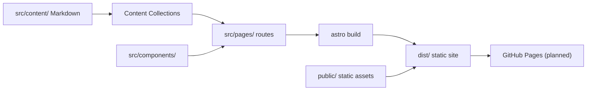

# Architecture

The macro technical shape: the stack, how the pieces fit, and the decisions behind them. Point to the code, do not restate it.

## Stack

- Astro as the static site generator; content in Markdown; no client-side JS framework.
- Shiki (native to Astro) for syntax highlighting — no extra highlighting library.
- Deployment target: GitHub Pages via GitHub Actions on `main` (planned).

## How it fits together

## Key decisions

- Static site, no backend: content is Markdown, so publishing is a commit, not a deploy pipeline.
- Component-oriented design: each UI block is a standalone Astro component in `src/components/` with its scoped style; pages compose these blocks.
- No dependency without justification; no package for what three lines of CSS do.
- `CNAME` (`emonin.dev`) at the root must never be deleted or moved.
- No secret in the repo: everything pushed is public.

## Gotchas

- Never push to `main` without a local `npm run build` passing first (once deployment is wired).
- Do not modify an article published more than 48 h ago without an `updated` frontmatter field or an in-text note.
- Article slugs: no accents, no spaces, ISO date prefix (e.g. `2026-11-30-pipeline-bdpm.md`).
