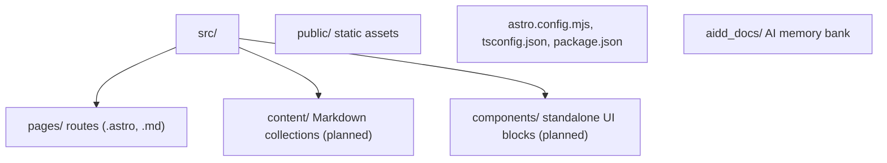

# Codebase Map

The macro layout: the top-level areas and what each holds. A map to navigate, not the full tree.

## Areas

- `src/pages/`: routes; each file maps to a URL.
- `src/content/`: Markdown content (blog articles), planned via Content Collections.
- `src/components/`: reusable Astro components with scoped styles, planned.
- `public/`: static assets served as-is (favicons today).
- `aidd_docs/`: the AI memory bank and project AI docs.

## Entry points

- `src/pages/index.astro` is the only page so far; `npm run dev` serves the site on `http://localhost:4321`.
