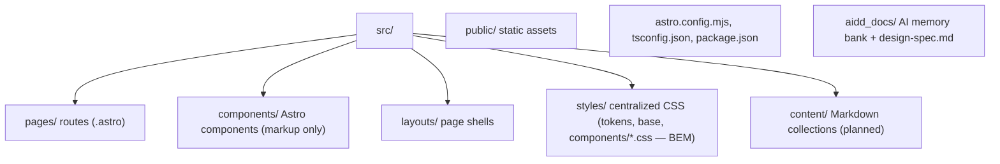

# Codebase Map

The macro layout: the top-level areas and what each holds. A map to navigate, not the full tree.

## Areas

- `src/pages/`: routes; each file maps to a URL.
- `src/content/`: Markdown content (blog articles), planned via Content Collections.
- `src/components/`: reusable Astro components, markup only (no `<style>`); styles live in `src/styles/components/`. Notable layout blocks: `site-header.astro` (brand lockup + nav underline + loader), `page-toc.astro` (floating page TOC), `site-footer.astro`.
- `src/layouts/`: page shells (`base-layout.astro` imports `src/styles/global.css`).
- `src/styles/`: all CSS — `tokens.css`, `base.css`, `global.css`, `components/*.css`, BEM naming.
- `public/`: static assets served as-is (favicons today).
- `aidd_docs/`: the AI memory bank, plus `design-spec.md` (the visual contract).

## Entry points

- `src/pages/index.astro` is the only page so far; `npm run dev` serves the site on `http://localhost:4321`.
