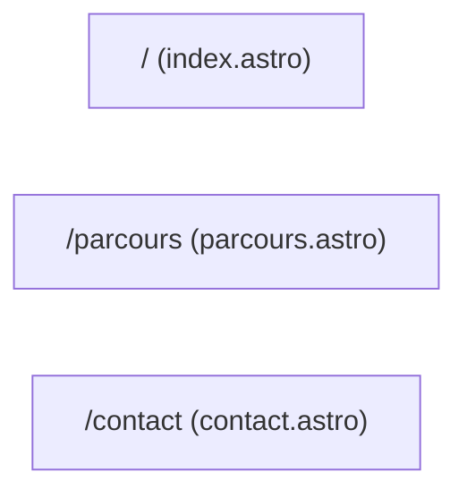

# Navigation

How the user moves through the app: routing and the page structure.

## Routing

- File-based routing of Astro: each file in `src/pages/` is a route named after the file.
- No client-side router; every navigation is a full page load (static site).

## Structure

- Three pages: home, parcours, contact.
- Header is STICKY (`position: sticky; top: 0`), one row on every breakpoint. Its 3px bottom border (`--nav-underline`) carries the desktop nav underline (sliding accent bar resting on the active link) and a page-load loader that sweeps once per load; no shadow. Mobile (<40rem): only the brand + a hamburger button (`data-nav-toggle`, top-right) show in the header; the menu opens as a dropdown with the nav links (hover/active = tinted row background, NO underline) and the theme switch as the last row of the menu. Desktop: links inline with underline + theme switch inline at the end of the row.
- The floating availability badge ("En formation") collapses to a dot on mobile (<40rem) but is focusable: tapping the dot expands it to show the full status (collapses back on blur).
- The floating page TOC (`page-toc.astro`, reusable) is DISABLED for v1: not rendered in `parcours.astro`. Component, `page-toc.css`, the `toc` field in `parcours.md` and the section `id` props are kept for a later release. When re-enabled: compact (square icon cells) / expanded on hover (labels slide open, links full width); active link on `accent-hover`; active section via IntersectionObserver + bottom-of-page rule.
